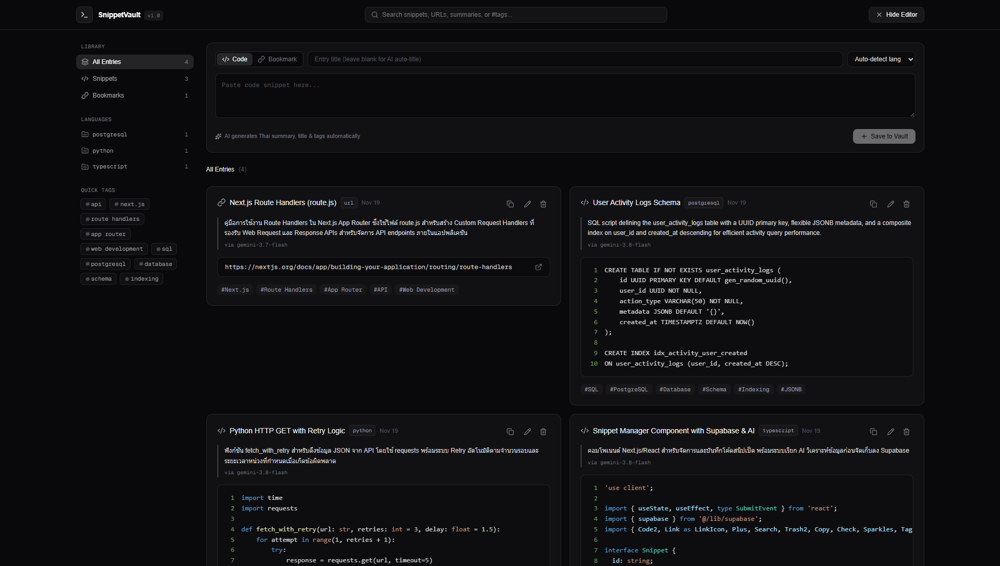

# 🚀 AI Snippet & Bookmark Manager

## 💡 Why I Built This (Problem & Solution)

While GitHub is great for full repositories and version control, developers constantly encounter **"micro-knowledge"** during daily work—such as reusable SQL queries, utility functions, regex patterns, and technical documentation links.

* **The Problem (Save Fast, Lose Later):** Existing tools like GitHub Gist or browser bookmarks create friction. Developers often skip naming files, writing descriptions, or organizing tags when saving things in a hurry—making it nearly impossible to search and retrieve them weeks later.
* **The Solution (Zero-Friction AI Indexing):** **SnippetVault** eliminates manual organization. Simply paste raw code or a URL and hit save—Google Gemini automatically infers the programming language, generates a concise title, summarizes the core logic, and assigns searchable tags in seconds.
* **Verified & Context-Ready:** Unlike re-prompting an LLM from scratch every time, this vault acts as a personal archive of battle-tested snippets paired with official docs, enabling instant retrieval by keyword, language, or tag.

A full-stack developer productivity tool for storing, organizing, and searching code snippets and web bookmarks—powered by **Google Gemini AI** for automatic title generation, programming language detection, summarization, and smart tagging.

🔗 **Live Demo:** [https://ai-snippet-manager-one.vercel.app/](https://ai-snippet-manager-one.vercel.app/)

---

## ✨ Key Features

- **🤖 AI Auto-Analysis (Gemini API):**
  - **Auto-Title Generation:** Automatically generates a concise, meaningful title if left blank.
  - **Auto-Detect Language:** Identifies the programming language of pasted code snippets (TypeScript, Python, SQL, Bash, HTML, etc.).
  - **Smart Summarization & Tagging:** Summarizes code functionality or webpage content and generates relevant searchable tags.
- **🛡️ Resilient Model Fallback Chain:** Implements a sequential fallback mechanism across Gemini models (`gemini-3.8-flash-lite`, `gemini-3.8-flash`) to handle API high-demand spikes (`503 Unavailable`) without interrupting user experience, displaying the exact model used on each card.
- **🎨 Syntax Highlighting:** Renders code snippets with line numbers and VS Code Dark+ theme via `react-syntax-highlighter`.
- **✏️ Full CRUD & Inline Edit Mode:** Create, read, update (title, code, language, AI summary, tags), copy to clipboard, and delete snippets seamlessly.
- **🔍 Instant Search & Multi-Filter:** Filter records by type (`Code`, `Bookmark`), programming language, or search across titles, content, summaries, and `#tags`.

---

## 🛠️ Tech Stack

- **Frontend:** Next.js (App Router), React, TypeScript, Tailwind CSS, Lucide Icons
- **Backend:** Next.js API Routes (Serverless Functions)
- **Database:** Supabase (PostgreSQL)
- **AI Integration:** Google GenAI SDK (`@google/genai`) with Structured JSON Schema Output
- **Deployment:** Vercel

---

## 🏗️ Architecture & Engineering Highlights

1. **Structured JSON Output:** Uses Gemini's `responseSchema` to guarantee deterministic JSON responses (`suggestedTitle`, `detectedLanguage`, `summary`, `tags`), preventing parsing errors on the frontend.
2. **Server-Side Web Scraping for Bookmarks:** When saving a URL, the backend API fetches and strips HTML tags from the target webpage to provide context for AI summarization, with an automatic timeout fallback to URL-based analysis if the site blocks scraping.
3. **Graceful Degradation:** If all AI models are unreachable, the application smoothly falls back to saving the snippet with default metadata so user data is never lost.

---

## ⚙️ Local Setup

1. Install dependencies:
   npm install
2. Configure Environment Variables
   Create a .env.local file in the root directory and add:
   NEXT_PUBLIC_SUPABASE_URL=your_supabase_project_url
   NEXT_PUBLIC_SUPABASE_ANON_KEY=your_supabase_anon_key
   GEMINI_API_KEY=your_google_gemini_api_key
3. Database Schema (Supabase SQL Editor):
   create table public.snippets (
   id uuid default gen_random_uuid() primary key,
   created_at timestamp with time zone default timezone('utc'::text, now()) not null,
   title text not null,
   type text not null,
   content text not null,
   language text default 'plaintext',
   ai_summary text,
   ai_model text,
   tags text[] default '{}'
   );
4. Run the development server:
    npm run dev